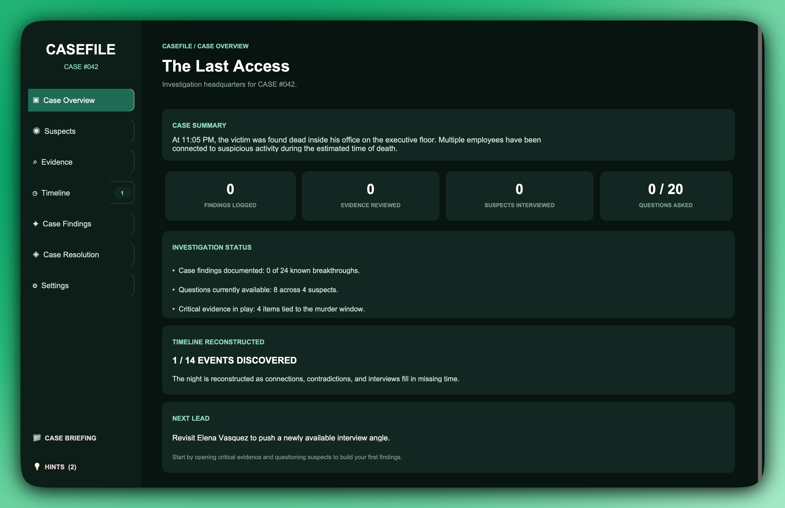
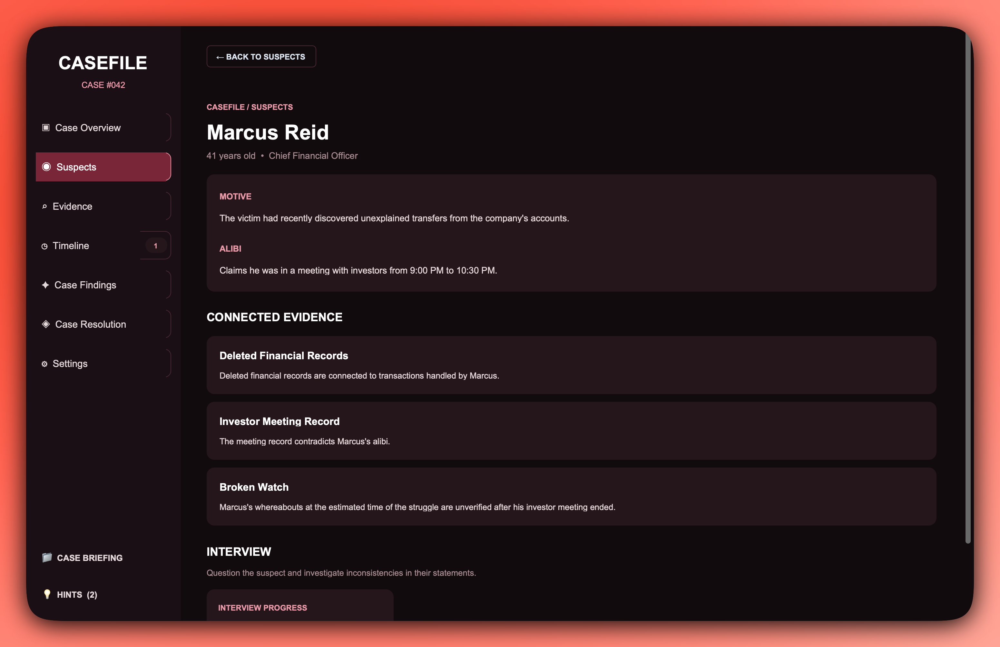
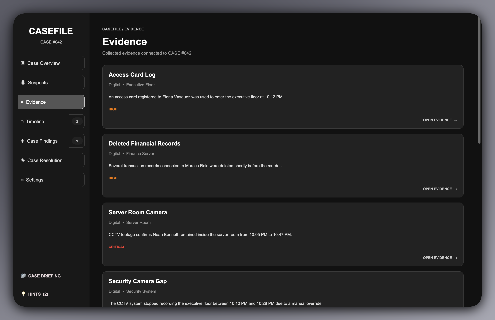
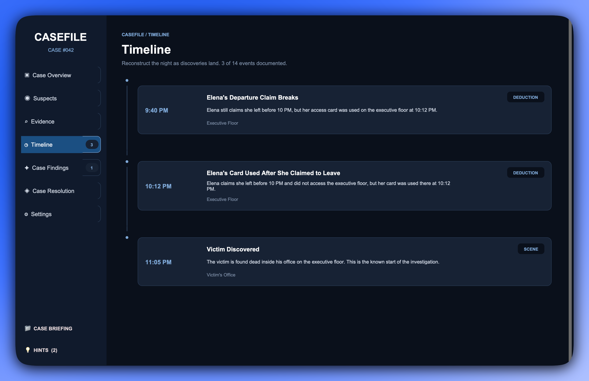

<div align="center">

# 🕵️ CASEFILE #42

### Every suspect has a story. Every piece of evidence tells another.

**A single-case, story-driven detective game built with Python, CustomTkinter, and SQLite.**

Investigate a murder. Question four suspects. Connect the evidence. Build a theory that holds up.

</div>

---

## The Case

A company executive is found dead inside his office at approximately **11:05 PM**.

Four people are connected to the investigation. Each has a possible motive, an alibi, and something worth questioning. Missing surveillance footage, suspicious security records, and conflicting statements leave more questions than answers.

**Your objective:** establish what happened, determine who is responsible, and support your conclusion with evidence—not guesses.

## Screenshots

### Case overview

Get oriented with the investigation and the details of the murder.



### Suspect interviews

Examine motives, compare alibis, and challenge statements as the investigation develops.



### Evidence investigation

Review physical, digital, and documentary clues and work out what they reveal.



### Timeline reconstruction

Piece together the events surrounding the crime as new findings become available.



## Gameplay

- **Interview four suspects:** Investigate their backgrounds, motives, and alibis; unlock additional questions through discoveries.
- **Examine evidence:** Study physical objects, security records, and other clues from the case.
- **Connect clues:** Combine related evidence to uncover deductions, contradictions, and investigative leads.
- **Reconstruct the timeline:** Track the sequence of events as the picture becomes clearer.
- **Confront inconsistencies:** Use collected evidence to challenge suspect statements.
- **Review findings:** Keep track of deductions and contradictions in the investigation board.
- **Use contextual hints:** Get limited guidance when you need a nudge.
- **Submit a final theory:** Resolve the case with a conclusion backed by findings.

### Investigation flow

```text
Explore the case → Examine evidence → Interview suspects
              ↓
       Connect related clues
              ↓
       Discover new findings
              ↓
   Unlock questions and timeline details
              ↓
   Expose contradictions → Submit your theory
```

## Themes

Switch between **Midnight Blue**, **Crimson Noir**, **Emerald Investigation**, and **Monochrome**.

## Getting Started

### Requirements

- Python 3.10+
- A desktop environment with Tkinter support

**No MySQL server, account, or database password required.** CASEFILE uses SQLite, included with Python.

### 1. Clone the project

```bash
git clone https://github.com/Shadow-Monarch-33/Casefile-042.git
cd Casefile-042
```

### 2. Create and activate a virtual environment

**macOS / Linux**

```bash
python3 -m venv .venv
source .venv/bin/activate
```

**Windows (PowerShell)**

```powershell
python -m venv .venv
.venv\Scripts\Activate.ps1
```

### 3. Install the dependency

```bash
pip install -r requirements.txt
```

### 4. Initialize the case database

```bash
python setup_database.py
```

This creates a local `casefile.db` file and seeds the suspects, evidence, timeline, and evidence relationships. Running setup again is designed not to overwrite existing case records.

### 5. Launch the game

```bash
python app.py
```

> On macOS or Linux, use `python3` instead of `python` if that is the command available in your environment.

## Built With

| Technology | Role |
| --- | --- |
| Python | Game mechanics and application logic |
| CustomTkinter | Desktop interface and themes |
| SQLite (`sqlite3`) | Local relational storage for case content |

## Project Structure

```text
Casefile-042/
├── app.py                 # Game UI and investigation logic
├── database.py            # SQLite connection helper
├── setup_database.py      # Schema and initial case data
├── requirements.txt       # Python dependency
├── images/                # README screenshots
│   ├── casefile_overview_green.png
│   ├── casefile_suspects_red.png
│   ├── casefile_evidence_grey.png
│   └── casefile_timeline_blue.png
├── README.md
├── LICENSE
└── casefile.db             # Generated locally; ignored by Git
```

## Current Scope

CASEFILE #42 is a **single-case desktop game**. Investigation progress is currently held in memory during a session rather than saved between launches. A standalone packaged application is not yet provided.

Future possibilities include save slots, additional cases, more deduction mechanics, and desktop builds.

## About

CASEFILE #42 explores how a relational database, a Python desktop interface, and interconnected investigative mechanics can come together in an interactive mystery.

<div align="center">

---

**CASEFILE #42 — Follow the evidence. Question everything.**

</div>
